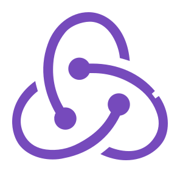
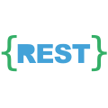

    

<h1 align="center">Hello , welcome to my corner of GitHub.</h1>

    

  I design and lead the delivery of cloud-native, distributed platforms, from architecture and scoping through to production. 
  I've built them across AI, fintech and robotics, with an emphasis on security, horizontal scale and reliable delivery.

    

<ul align="left">
  <li>
     <b>Currently:</b> Tech Lead &amp; Delivery Owner at <b>CNTXT AI</b>, where I lead the architecture of an AI agent platform (API gateway, zero-trust service identity, automated API delivery) and a real-time robotics data platform built for horizontal scale.
  </li>
  <li>
     <b>Track record:</b> grew microservices infrastructure ~300% while the user base went from 10K to 50K+; shipped fintech features behind $500M+ in digital-asset transactions; led merchant integrations on a payments platform serving 11M+ users.
  </li>
  <li>
     <b>Ask me about:</b> distributed systems, API gateways, zero-trust authentication, event-driven architecture, Kubernetes &amp; GitOps, AI agent platforms, fintech &amp; payments, and engineering leadership.
  </li>
  <li>
     <b>Reach me:</b> <a href="https://www.linkedin.com/in/otabek-rizakulov">LinkedIn</a> · <a href="mailto:otabek.rzakulov@gmail.com">otabek.rzakulov@gmail.com</a> · <a href="https://t.me/sophisticated_20">@sophisticated_20</a>
  </li>
  <li>
    &nbsp;&nbsp;&nbsp;<b>Fun fact:</b> I automate things just to avoid doing them manually once.
  </li>
</ul>

<table align="center">
  <tr>
    <td align="center" width="103">
       React
    </td>
    <td align="center" width="103">
       Redux
    </td>
    <td align="center" width="103">
       Next.js
    </td>
    <td align="center" width="103">
       TypeScript
    </td>
    <td align="center" width="103">
       Nuxt.js
    </td>
    <td align="center" width="103">
       Nest.js
    </td>
    <td align="center" width="103">
       Node.js
    </td>
    <td align="center" width="103">
       Express
    </td>
  </tr>
  <tr>
    <td align="center" width="103">
       Python
    </td>
    <td align="center" width="103">
       Django
    </td>
    <td align="center" width="103">
       REST API
    </td>
    <td align="center" width="103">
       Solidity
    </td>
    <td align="center" width="103">
       Three.js
    </td>
    <td align="center" width="103">
       D3.js
    </td>
    <td align="center" width="103">
       Material UI
    </td>
    <td align="center" width="103">
       Tailwind
    </td>
  </tr>
  <tr>
    <td align="center" width="103">
       Sass
    </td>
    <td align="center" width="103">
       Bootstrap
    </td>
    <td align="center" width="103">
       AWS
    </td>
    <td align="center" width="103">
       MongoDB
    </td>
    <td align="center" width="103">
       MySQL
    </td>
    <td align="center" width="103">
       PostgreSQL
    </td>
     <td align="center" width="103">
       SQLite
    </td>
    <td align="center" width="103">
       Docker
    </td>

  </tr>
</table>

 
 

